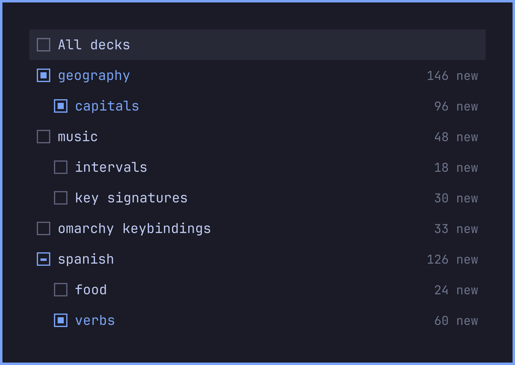

# omengram

Spaced-repetition flashcards in the Omarchy bar, scheduled the way Anki
schedules them.

It studies a library of decks, with a picker in the bar panel for which decks
and tags to study and how much of each a day, and can start from a copy of your
Anki collection.

omengram is a fork of [yamz8/omanki](https://github.com/yamz8/omanki) (MIT),
which the scheduler, the two surfaces and the file handling come from. It is its
own plugin, with its own id, decks and progress, so the two can be installed
side by side.

There are two surfaces onto the same cards:

- **The bar panel.** Click the glyph to clear a few cards in passing.
- **The fullscreen overlay.** `Super + Ctrl + J` for actually sitting down to a
  deck — a bigger card face, on a surface with nothing else on it.

Both run the same session and write the same progress, so a card answered in
one is answered in the other. Either way the loop is the same: question, space
to reveal, then one of four grades, each labelled with when the card would
come back.



## Install

```bash
omarchy plugin add https://github.com/gudetimes1234/omengram.git --enable
```

That clones the repo into `~/.config/omarchy/plugins/gudetimes.omengram/`, validates
it against the plugin manifest schema, and offers to place the bar widget. To
update later:

```bash
omarchy plugin update gudetimes.omengram
```

A fresh install has no deck, so the panel opens on `No cards yet`. The repo
ships one to start from — 33 cards covering Omarchy's own keybindings and
commands, which is what the plugin was written to learn:

```bash
mkdir -p ~/.local/share/omengram
cp ~/.config/omarchy/plugins/gudetimes.omengram/cards.example.json \
   ~/.local/share/omengram/cards.json
```

Copying it is the only time anything places a deck for you; the plugin itself
never writes one unless you add a card through the `a` composer.

The fullscreen overlay is summoned by a keybind, which you add yourself — see
[Placing it and binding it](#placing-it-and-binding-it) below.

## Choosing what to study

Press `d` in the bar panel, or click the line above the card. Three tabs, each
change saved as it is made:

- **Decks** — tick any number. A folder includes the decks in it, and unticking
  one of those leaves the rest of the folder. *All decks* is nothing ticked.
- **Tags** — the tags on the cards in those decks. Tags nest with `::`, so `sd`
  includes `sd::caching`. Decks add up; tags then narrow them.
- **Limits** — new cards and reviews a day, for the whole day and for any deck
  or folder. A card has to fit under every limit above it. A dash is no limit;
  a deck's `0` is none today. Reviews held by a *deck's* limit never include
  cards still being learned.

`↑` `↓` move, `space` ticks (or switches between the two numbers on Limits),
`+` `-` change a limit, `c` clears it, `←` `→` change tab, `esc` goes back.

The overlay studies the same selection. The header names it (`NEW · infra ·
#sd`), so a short session is never mistaken for an empty library.

## Studying your Anki collection

If Anki is installed, its decks appear in the picker under **Anki**, beside the
library, and are studied straight from Anki's collection:

- **Anki schedules them.** Each grade is a real Anki review, with Anki's deck
  options, learning steps, FSRS if you use it, sibling burying and limits. The
  grade buttons show Anki's own intervals.
- **Syncing reaches your phone.** omengram syncs the collection with AnkiWeb,
  so reviews done here show up in AnkiDroid (or AnkiMobile) after it syncs, and
  reviews done there show up here. Press **Sync** in the bar panel or `y` on
  either surface; the bar also syncs 30 seconds after login and every 15
  minutes (`syncInterval`). The line above the card says how the last sync
  went, and in red when it needs you.
- **Limits only narrow.** A deck limit set in the picker can lower what Anki
  serves that day but never raise it. Tags narrow Anki's day too; to study by
  tag across limits, make a filtered deck in Anki.
- **Undo** works until the review has been synced. After that the answer is on
  AnkiWeb and Anki's own undo is the place for it.

### While Anki is open

Anki locks its collection while it runs. Install the small add-on in
`anki-addon/` and omengram goes through Anki instead, and a sync is Anki's own
sync, dialogs and all:

```bash
ln -s ~/github/omarchy-plugins/omengram/anki-addon ~/.local/share/Anki2/addons21/omengram_bridge
```

Restart Anki once. The add-on listens on `127.0.0.1:8767` only. Without it,
omengram says Anki is open and waits for it to close.

### While Anki is closed

omengram opens the collection for each request and closes it again, and makes
Anki's own backup before the first change each day. It syncs with the login
Anki already has, read from Anki's profile; the key is never copied, printed or
stored. Sign in to AnkiWeb in Anki once first. Two things are left to Anki:

- **A one-way sync.** When AnkiWeb and the collection can't be merged, omengram
  never picks a side. Open Anki and sync there.
- **Media.** Cards show as text here, so pictures and sounds are synced by Anki,
  not by omengram.

Set `anki` to `false` to leave Anki out entirely.

## Copying decks over from Anki

For studying Anki cards on omengram's own schedule instead, with nothing
written back:

```bash
/usr/local/share/anki/python/bin/python3 tools/import_anki.py --dry-run
/usr/local/share/anki/python/bin/python3 tools/import_anki.py
```

Copies every Anki deck into the library once, deck tree and tags included. Cards
are rendered through their own templates and flattened to plain text; pictures
become `[image]`. **They start as new cards on omengram's schedule and nothing is
written back to Anki** — only a temporary copy of the collection is opened, and
Anki has to be closed. Existing files are not replaced without `--force`. Cards
carry an id made from their note, so importing again keeps their progress.

## Placing it and binding it

`omarchy plugin add --enable` offers to place the bar widget. If you skipped
that, or want it somewhere else:

```bash
omarchy bar put gudetimes.omengram --section right
```

Or add `{ "id": "gudetimes.omengram" }` to a section of `bar.layout` in
`~/.config/omarchy/shell.json` by hand.

The overlay has no default keybind. In `~/.config/hypr/bindings.lua`:

```lua
o.bind("SUPER + CTRL + J", "omengram", "omarchy-shell shell toggle gudetimes.omengram")
```

Pick that key with care. `SUPER + CTRL + M` looks free and is not — it sits one
modifier key away from Omarchy's stock `SUPER + SHIFT + M` "Music" binding, and
missing Ctrl for Shift launches `omarchy-launch-spotify`, which offers to
install Spotify if it is absent. Check a candidate against the live table
rather than the config, since the two can disagree:

```bash
omarchy menu keybindings --print | grep -i "SUPER CTRL"
```

A note if you are hacking on this: the Omarchy shell hot-reloads plugin code,
but this plugin sets `keepLoaded: true` so the session survives between
summons — which also means the shell holds the overlay instance across close
and never rebuilds it from changed source. Editing a `.qml` and reopening
shows you the old object; `omarchy-shell shell rescanPlugins` does not help
either. Run `omarchy restart shell` to see a change. Setting `keepLoaded` to
`false` restores ordinary save-and-reopen reloading if you want it while
iterating, at the cost of a cold session each summon.

Separately, a shell process that started *before* the plugin directory existed
cannot load a newly added overlay entry point at all — Qt caches its view of
the filesystem and reports it as a spurious "File name case mismatch". The
same restart clears it.

## Keys

| Key | Does |
|-----|------|
| `space` / `enter` | Reveal the answer, then grade it Good |
| `1` `2` `3` `4` | Again / Hard / Good / Easy |
| `u` | Undo the last answer |
| `y` | Sync with AnkiWeb |
| `d` | Choose what to study (bar panel only) |
| `↑` `↓` | Scroll a long card |
| `s` | Statistics |
| `←` `→` | Move between statistics tabs |
| `h` `l` | Move between statistics tabs (bar panel only) |
| `l` | Restore suspended leeches (overlay) |
| `a` | Add a card (overlay only) |
| `r` | Reload the deck from disk |
| `esc` | Close |

Same keys on both surfaces, apart from `a`: the composer is a form, and a form
typed into a popup that closes when it loses focus is not a trade worth making.
`Super + Ctrl + J` toggles the overlay; the bar glyph toggles the panel.

`Tab` is left alone. It moves between bar panels, which is the shell's own
convention and every other panel answers it that way — so the statistics tabs
are walked with the arrow keys instead, which is what a row of tabs suggests.

In the bar panel `h` and `l` walk them too, because the shell turns those into
movement before any panel sees them. That is also why `l` cannot mean "restore"
there the way it does in the overlay: the key never arrives. The panel's leech
tab carries a button instead, which is the more discoverable of the two anyway.

## Undo

`u` takes back the last answer. The card returns to exactly the state it was in
— its memory, due date, lapse count, and the day's new-card allowance — and comes
back **revealed and in front of you**, so the next keystroke can be the grade
you meant. Taking back a card's very first answer removes its history
altogether rather than leaving a zeroed entry behind, so it counts as new
again.

You can walk back up to 25 answers. The stack lives in memory and is per
sitting: it starts empty each time a surface opens, and each surface keeps its
own. That is deliberate — undo is for the grade you just fumbled, and a
snapshot from an hour ago may no longer be true after the other surface has
been answering the same deck.

`u undo` appears in the footer only when there is something to take back.

## Statistics and adding cards

`s` on either surface, `a` in the overlay.

Both surfaces use the same **tabs** — `DECK`, `DUE`, `TODAY`, and `LEECHES`
once there is a leech to show — walked with `←` and `→`, or clicked. Same names
and same order on both, because two surfaces should not be two things to learn.

They arrived there for different reasons. The panel is about a card wide, where
one page would be a column of squeezed rows saying everything badly. The
overlay's page *fitted* — but fitting is not reading: a composition bar, a week
of forecast, six figures at one weight and a paragraph of prose all arriving at
once gave the eye nowhere to land, and it read as a table rather than an
answer. Splitting it by question — what is the deck, what is coming, how did
today go, what has gone wrong — spends the room this surface always had on one
thing instead of four.

What differs is what a tab may hold. At the overlay's width each one carries a
legend, a taller plot and a full sentence, where the panel's has to make do
with a caption.

On both surfaces the strip rides on the end of the `STATISTICS` line rather
than sitting under it. A row of small-caps tabs directly below the small-caps
word crowded both, and in the panel it also spent a row there are few of.

Both read the same numbers, so there is one calculation behind two
presentations rather than two of either.

**Statistics** shows the deck's composition — mature, young, learning, new —
what falls due over the next seven days, and today's figures. Today leads with
the one number and gives its parts underneath: `answered` is `reviews + new` by
construction, so showing all three as peers was three numbers carrying two
facts. *Retention* comes from the review log: the share of reviews in the
last 30 days not graded *Again*, counting cards already in review and not
learning steps, the way Anki measures true retention. Beside it is the deck's
average FSRS difficulty, and ease for Anki's cards.

**Leeches** appear in both, but only once there are any — a deck without them
says nothing about them, and in the panel the tab itself stays away. You get
the count, how many are suspended, and a way to put every suspended card back:
`l` in the overlay, or the button on the panel's leech tab. That is deliberately
the same view as the count: there is no card browser to go hunting in, so the
count and the way back have to be in one place or suspending would be a
one-way door. Restoring keeps the leech mark, so a card that goes on lapsing is
raised again at the next threshold rather than immediately.

When a card becomes a leech mid-session, the surface says so at the moment it
happens rather than letting the card quietly vanish.

**Adding a card** is the overlay's alone, and takes a front, a back, and
optional comma-separated tags;
`enter` moves between fields and saves from the last one. The form clears and
stays open, so a run of cards is one flow.

Writing goes read-modify-write over the deck's actual text, so existing cards
keep their order and every field they had, including ones this plugin knows
nothing about. Two things it will not do: overwrite a deck it could not parse —
it hands the file back untouched and says so — or accept a front that already
exists, since a card is identified by its front and a duplicate would share one
schedule and never be seen. What it does not preserve is your *formatting*: the
file is reserialized at two-space indent, so hand-tuned whitespace does not
survive an in-app add.

## Your decks

Decks are the `.json` files under `~/.local/share/omengram`, yours to edit. A
folder is a parent: `infra/backend.json` is the deck `infra › backend`, and
`infra.json` beside the folder holds the parent's own cards. Files are found up
to eight levels down; links, dotfiles and anything over 256 KiB are not read. A
file that does not parse is named in the panel and the rest still load. Names
beginning `gleamdrill:` are reserved.

Each file is a list of cards:

```json
{
  "cards": [
    { "front": "Toggle the scratchpad", "back": "Super + S", "tags": ["omarchy"] }
  ]
}
```

A bare `[ ... ]` array works too. Entries missing a front or a back are
skipped rather than shown blank, and the panel says so if the file does not
parse. Press `r` in the panel, or just close and reopen it, to pick up edits.

[`cards.example.json`](cards.example.json) in this repo is a working deck in
this format — copy it as shown in [Install](#install), or read it as a worked
example before writing your own.

A card is identified by a hash of its **front**, not by its position in the
file, so you can reorder the deck or fix a typo on the back without losing a
card's history. Changing the front is deliberately a new card — the question
changed, and the old schedule was earned answering a different one. Set an
explicit `"id"` on a card if you want to edit a front and keep its progress.

Scheduling progress is kept separately, in
`~/.local/state/omarchy/omengram.json`, so nothing the plugin writes can clobber
the deck you are writing by hand. Deleting that file resets every card to new
and leaves your deck alone.

Both surfaces can be open at once and both write that file, so every save is
read-merge-write rather than a blind overwrite: the document on disk is read
back, reconciled per card by which entry changed most recently, and only then
replaced. Without that, whichever surface saved last would erase whatever the
other had just answered.

## Settings

Set these on the plugin's entry in `~/.config/omarchy/shell.json`; it
hot-reloads on save.

| Setting | Default | Does |
|---------|---------|------|
| `deckDir` | `~/.local/share/omengram` | The library. `~` is expanded. |
| `deck` | *(none)* | Study this one file instead of the library. |
| `decks` | *(all)* | Decks to study, by id. Set from the picker. |
| `limits` | *(none)* | Per-deck limits, `{ "id": { "new": 10, "reviews": 50 } }`. Set from the picker. |
| `newPerDay` | `20` | How many unseen cards to introduce per study day, across every deck. `0` reviews only. |
| `showCount` | `true` | Show the waiting count next to the bar glyph. |
| `tags` | *(none)* | Restrict the session to cards carrying any of these tags. Set from the picker. |
| `reviewsPerDay` | `0` | Cap how many due cards a day serves. `0` means no cap. |
| `retention` | `90` | The share of reviews FSRS schedules you to pass, as a percentage (70–99). Higher means shorter gaps. |
| `leechThreshold` | `8` | Lapses before a card counts as a leech. `0` turns leeches off. |
| `leechSuspend` | `true` | Take a leech out of the rotation rather than only marking it. |
| `anki` | `true` | Study Anki's collection beside the library. |
| `ankiProfile` | *(the only one)* | Which Anki profile to use. |
| `syncInterval` | `15` | Minutes between syncs with AnkiWeb. `0` syncs only when asked. |

`newPerDay`, `reviewsPerDay`, `retention` and the leech settings apply to
library decks. Anki decks use their own deck options in Anki.

```json
{ "id": "gudetimes.omengram", "newPerDay": 10, "decks": ["spanish"], "tags": ["verbs"] }
```

`reviewsPerDay` caps only *reviews* — cards that existed before today. Cards
introduced today are the `newPerDay` allowance's business, so a day of new
cards cannot silently eat the review budget. When the cap bites, the most
overdue cards are the ones served.

`tags` takes a list or a bare string, matches case-insensitively, and is a
union rather than an intersection — `["verbs", "food"]` keeps a card carrying
either. An untagged card is excluded whenever a filter is set. Both surfaces
share the filter and show it in the header (`NEW · #verbs`), so a short session
is never mistaken for an empty deck.

Everything except `decks`, `tags` and `limits` is declared in `manifest.json`
under `barWidget`, with types and ranges, so the shell knows the defaults
without being told. Those three are left out on purpose: the schema has no list,
and `"verbs, food"` written as one string would be read as a single tag by that
name and match nothing. The picker writes them as what they are.

Note that settings are read when the shell builds the widget: adding a key to
an existing entry did not take effect here until `omarchy restart shell`, even
though layout changes hot-reload.

## How the scheduling works

FSRS-6, the scheduler Anki uses by default. `Fsrs.js` is a port of
GleamDrill's FSRS, checked against the reference py-fsrs: `tests/fsrs-vectors.json`
is py-fsrs's own output (`tools/gen_fsrs_vectors.py`), and `tests/fsrs.test.mjs`
compares every value.

FSRS keeps two numbers per card. **Stability** is how many days until your
chance of recalling it falls to 90%; **difficulty** runs from 1 to 10. Each
answer updates both from the grade and from how long it had been, and the
next gap is the time until recall falls to the `retention` you aim for (90%).

A **new** card is shown after 1 minute, then after 10, then graduates; *Easy*
skips the steps. Forgetting a card in review (*Again*) is a **lapse**: it
relearns after 10 minutes and comes back with a shorter gap and a higher
difficulty. Answering a card long after it was due, and still knowing it,
counts for more than answering on time, since it held for longer.

Each review interval is **spread** over a few days around itself, as FSRS
does, so cards answered together do not stay clumped together. The spread is
applied when you answer, not when the grades are priced, so the interval on
each button holds still while you decide.

Progress from before FSRS (SM-2, which omengram used first) carries over: a
card's interval becomes its stability and its ease its difficulty, and its
due date does not move.

A card that keeps being forgotten becomes a **leech**. Past some number of
lapses the card is the problem rather than your memory — the question is
ambiguous, or it is really two facts sharing one front — and grinding it every
few days costs more than it returns. At eight lapses omengram marks the card and
takes it out of the rotation; it is raised again every four lapses after that,
so a leech you decide to keep does not nag on every slip. Both numbers follow
Anki's.

A suspended card is hidden, not rewritten. Its memory and due date go
on being exactly what the scheduler last made them, so restoring one puts it
back where it was rather than at the beginning.

Anki also tags the note `leech`. This plugin does not, because the deck is your
file: it is only ever written through the `a` composer, and writing a tag into
it on a lapse would break that for a card you never touched. The mark lives in
the progress file instead, and the statistics view is where you see it.

Set `leechThreshold` to `0` to turn leeches off, or `leechSuspend` to `false`
to mark them without taking them out.

The study day rolls over at **4am** local time, not midnight, so a card
answered at 1am counts toward the day you are still awake in. That is what the
`newPerDay` allowance is measured against.

## Troubleshooting

**Everything disappeared after `omarchy refresh shell`.** That command resets
`~/.config/omarchy/shell.json` to Omarchy's defaults, and a third-party plugin
is enabled by the presence of its id in that file — the shell's storage rules
put it plainly: *a third-party plugin is enabled iff its id appears somewhere
in shell.json*. Resetting the file takes omengram's entry with it, so the bar
glyph goes and `Super + Ctrl + J` stops responding too; a disabled plugin is
never summoned, and the only trace is one line in the shell's log. Nothing is
lost — your deck and your progress are separate files and are untouched. Put
it back with:

```bash
omarchy plugin enable gudetimes.omengram
```

The config you had before is saved next to the new one as
`~/.config/omarchy/shell.json.bak.<timestamp>`, if there was more in it than
this one entry.

**The count next to the glyph looks stale.** Press `r` in the panel to re-read
the deck, or close and reopen it. A closed surface re-reads both files once a
minute on its own.

**A new setting had no effect.** Settings are read when the shell builds the
widget, so a key added to an existing entry needs `omarchy restart shell`.

## Requirements

Omarchy 4 (Quattro) or newer. No packages to install and no privileged
operations — the plugin is QML and JavaScript running inside the existing
`omarchy-shell` process, and uses only the shell's own `qs.Ui` and `qs.Commons`
modules.

Studying Anki's collection needs Anki itself (tested with 26.09): the bridge in
`bridge/` runs under Anki's bundled Python and Anki's own library. Syncing is
the one thing that uses the network, and only to AnkiWeb.

`node` is needed to run the test suite, but never to use the plugin.

Running a code drill's tests (Ctrl+R in the editor, or `t`) needs `python3`
and `bubblewrap` (`bwrap`). Without bwrap the tests refuse to run; everything
else works.

### Running a drill's tests

`bin/omengram-run` runs what you typed, with the card's tests, inside
bubblewrap, and nowhere else: if bwrap is missing or cannot start, it says so
and runs nothing. Inside, the code sees a read-only `/usr`, an empty `/tmp`,
no network, none of your files, and no environment, and it has no
capabilities. It is stopped after 8 seconds (6 of CPU), and is limited to 1 GiB
of memory, 1 MiB per file, 64 open files and 64 processes, so an endless loop
or a fork bomb ends as "stopped". Moving to another card stops a run that is
still going.

A case passes when `repr(expected) == repr(actual)`, as in GleamDrill. The
results are for you to look at; they never grade the card.

### What it writes

Worth knowing before you point this at your notes.

**`~/.local/state/omarchy/omengram.json`** — scheduling progress, written on
every answer. Entirely the plugin's own file.

**`~/.local/state/omarchy/omengram/reviews-YYYY-MM.jsonl`** — the review log,
one line per answer to a library card: the card, the grade, the memory before
and after, and how long it was on screen. Only ever appended to; an undo is a
line of its own. Mode 600. Anki's answers are in Anki's own log, not here.

**Your Anki collection**, when an Anki card is answered, undone or restored:
the same changes Anki makes when you review there. The selected deck is put
back afterwards, and Anki's backup runs first each day.

**`~/.local/state/omarchy/omengram-sync.json`** — how the last sync went, mode
600, with no login in it.

**The decks in `~/.local/share/omengram`**. A card added with `a` goes to the deck
of the card on screen, and the composer says which. Only ever appended to, and
only when you add a card through the `a` composer. If you never use it, the
plugin never writes your deck at all. When it does:

- existing cards keep their order and every field they carried, including ones
  this plugin knows nothing about;
- a deck it cannot parse is handed back untouched rather than overwritten —
  that being the one unrecoverable thing it could do;
- a duplicate front is refused, since a card is identified by its front and two
  would share a single schedule;
- **your formatting is not preserved.** The file is reserialized at two-space
  indent, so hand-tuned whitespace does not survive an in-app add.

Both files sit in directories anything running as you can write, while the
shell reading them is a long-lived process shared by the whole desktop. So both
are treated as untrusted input, and **both must live inside your home
directory** — a path outside it is refused rather than attempted.

Guarding the file is not enough on its own: `mkdir -p`, `mktemp` and `mv` all
follow a directory symlink, so a link planted at any component of a predictable
path — `~/.local`, `~/.local/state`, `~/.local/state/omarchy` — would redirect
the whole operation. So the helpers walk the chain one component at a time,
refusing any symlink and requiring a directory you own, then pin the final
directory with a file descriptor and verify what they pinned, doing every
subsequent operation through it. A directory swapped in after the walk cannot
move the write.

Directories that already exist keep their modes — `~/.local` is shared with
every other application and is not a plugin's to tighten. Only directories the
plugin creates are set private (0700), and the data files themselves are 0600.

Reads additionally refuse anything that is not a regular file and open
non-blocking, so a planted FIFO cannot stall the shell, stopping at 256 KiB.
A deck past that limit arrives truncated, which the parser recognises by size
and reports as *too large* rather than as a syntax error in your file — and
the `a` composer refuses to write a deck it only half read.
Writes send the document over stdin, so nothing in a card is ever interpolated
into a shell, and land via a fresh 0600 temp file renamed over the destination.

Card text is displayed with `Text.PlainText` at every sink. Decks are shared
and imported, and Qt's default `AutoText` interprets anything that looks like
markup — which would let a crafted card make the shell load remote or local
resources. The parser deliberately does **not** strip markup: a card teaching
HTML should survive intact, so safety belongs to the renderer.

## Remove

```bash
omarchy plugin remove gudetimes.omengram
```

That deletes `~/.config/omarchy/plugins/gudetimes.omengram/` and drops the plugin's
entry from `~/.config/omarchy/shell.json`, taking the bar widget with it.

Three things it does not touch, so remove them by hand if you want them gone:

- your decks, in `~/.local/share/omengram`
- your scheduling progress, at `~/.local/state/omarchy/omengram.json`
- any keybind you added to `~/.config/hypr/bindings.lua`

## Tests

The scheduler is deliberately free of QML types, so it runs under plain node:

```bash
node tests/scheduler.test.mjs
```

That covers the learning steps, interval growth and spreading, the credit for
answering late and the order the three passing grades keep, lapses at every
setting and the recovery from them, leeches and restoring them, the clamps,
deck parsing, an oversized deck being reported as such, queue order, the 4am
rollover, document merging, and the hardening on both file-I/O snippets.

Those tests are pure: they know nothing about processes, files, or two
surfaces being open at once. Every bug this plugin has actually shipped lived
in that gap and survived a green suite — a writer that silently dropped every
save after the first, and two surfaces overwriting each other's answers. So
there is a second, slower suite that drives the real shell with real
keystrokes and reads the file back after every action:

```bash
tests/soak.sh
```

It needs a running `omarchy-shell` and `wtype`, and it takes the keyboard
while it runs, so it is deliberately not part of the unit suite. Run it after
any change to the save path, the surfaces, or the session lifecycle. Every bug
this plugin has shipped fails it.

It covers repeated saves, undo, the two surfaces not erasing each other,
adding several cards in a row, refusing a duplicate front, refusing an
unparseable deck and recovering afterwards, a card lapsing its way to a leech
and being restored, touring the views without breaking review, and a configured
setting reaching both surfaces rather than only the one the shell hands its
entry to. It also scans the shell's log, since a view can render and still
throw on every binding without any file-based assertion noticing.

A refusal is checked by its stated reason and not only by the deck failing to
change. "The file did not change" is satisfied just as well by an add that
never happened, which is not a hypothetical: an earlier version of this script
counted a different file than the plugin wrote to, and the two refusal
assertions stayed green throughout. So every refusal is written to the log, and
the soak asserts the reason it expected actually appeared.

The deck, `shell.json` and your scheduling progress are backed up and restored
on exit, including on an interrupt. The deck it uses is the one your settings
point at, not the default path — it reads `deck` from `shell.json` the way the
plugin does, and prints all three paths when it starts.
Assertions poll rather than sleep: every action starts a read, a merge and a
write, so a fixed sleep tests the machine's mood rather than the plugin.

The Anki side runs against a throwaway collection with made-up decks, never
yours, under Anki's own Python:

```bash
/usr/local/share/anki/python/bin/python3 -I tests/test_bridge.py
/usr/local/share/anki/python/bin/python3 -I tests/test_sync.py
```

The sync tests use a fake AnkiWeb, a fake login, and a fake Anki window for
the add-on, so they need no network and no account.

Drills have their own tests: the diff and editor helpers under node, the
GleamDrill importer against a made-up checkout, and the sandbox, with runs
that are meant to blow up (hence `prlimit`, which keeps them from leaving core
dumps):

```bash
node tests/drill.test.mjs
python3 tests/test_import_gleamdrill.py
prlimit --core=1:1 -- python3 tests/test_runner.py
tests/qml/run.sh drill-keys
```

The last one types into a drill with real key presses in an off-screen
Quickshell; it needs a Wayland session to start in, so it is local only.

## Layout

| File | What it is |
|------|------------|
| `Anki.js` | Scheduling, deck parsing, settings, file I/O snippets. No QML types. |
| `Reviewer.qml` | The session: deck, progress, queue, persistence, card face. |
| `GradeButtons.qml` | The four priced grade buttons, shared by both surfaces. |
| `CardComposer.qml` | The add-a-card form behind `a`, in the overlay only. |
| `StatsView.qml` | The statistics behind `s` in the overlay, on one page. |
| `PanelStats.qml` | The same numbers in tabs, for the width the bar panel has. |
| `StatsTabs.qml` | The tab strip, which rides on the panel's section header. |
| `StudyPicker.qml` | Decks, tags and limits, behind `d` in the bar panel. |
| `tools/import_anki.py` | Copies an Anki collection into the library, once. |
| `AnkiSource.qml` | Anki's side of a session: its next card, counts and decks. |
| `AnkiBridge.qml` | The connection to `bin/omengram-anki`, one process per surface. |
| `AnkiSync.qml` | Syncing with AnkiWeb, and the timer the bar runs. |
| `SyncStatus.qml` | The sync line and its button. |
| `bridge/` | The Python side, run under Anki's Python: reading and answering cards, syncing. |
| `anki-addon/` | The add-on that lets all of it go through Anki while Anki is open. |
| `Panel.qml` | The bar widget and the panel chrome around the session. |
| `Omengram.qml` | The fullscreen overlay chrome around the same session. |

`Reviewer` and `GradeButtons` know nothing about what is hosting them — the
host owns sizing — so the rules and the review loop exist once rather than once
per surface.

While a surface is on screen its session ticks every second, so a card due in
a minute arrives on its own. While it is closed it ticks once a minute and
re-reads both files, which is what keeps the bar's count honest when cards
come due unattended or the other surface has been answering them.

## License

MIT — see [LICENSE](LICENSE). The original is by [yamz8](https://github.com/yamz8/omanki).
